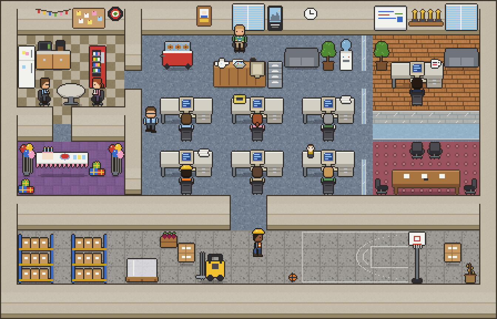

# Agent Agency

A pixel-art paper-company office where your Claude Code agents come to work. Every running agent
becomes a member of staff: they sit at a desk while they work (the CRT lights up), take breaks
when they're idle, and share the floor with a boss who is always around and always has something
to say.



Runs as a **VS Code extension** (a panel next to the terminal) or as a **standalone browser app**.
The look is inspired by the feel of a TV-sitcom regional office; all characters, art and lines are
original (no show names, logos, characters or actor likenesses).

## Life in the office

- **Working agents** sit at one of six bullpen desks or at reception; their computer screen
  flickers while they type. Bubbles show when an agent needs your approval or has finished.
- **The boss** is always in the office (he is not an agent). He works at the corner-office desk
  with the "World's Best Boss" mug, drops by agents' desks, calls conference-room meetings, makes
  announcements nobody asked for, raids the break room and the pretzel cart, shoots hoops, dances
  at the party, and walks over to congratulate agents who finish a turn. About 60 original lines.
- **Break time**: idle agents leave their desks for the break room, the party room, the water
  cooler, the couch or the warehouse basketball court, and goof off there: quips, dancing, jump
  shots with a real ball. Now and then one takes the forklift for a shift, shuttling pallets
  across the warehouse.

The office (28x18 tiles): reception, the bullpen, a break room, a party room, the boss's glass
corner office, the conference room, and a warehouse with stock on one side and a half-court on
the other.

## Install

Build the extension from source (below), then:

```powershell
code --install-extension agent-agency.vsix
```

Open the **Agent Agency** tab in VS Code's bottom panel and click **+ Agent** to start Claude Code
at a desk. Sessions you start yourself in a terminal are picked up too. On first run the app asks
before adding hook entries to `~/.claude/settings.json` (it backs the file up first); if you
decline, it falls back to reading session transcripts.

Browser version:

```powershell
node dist/cli.js --port 3200
```

Open the URL it prints (it includes an access token; without it the page is watch-only).

## Build from source

Requires Node 22.

```powershell
npm ci
npm run vsix        # writes agent-agency.vsix
```

`npm run vsix` runs the full build (protocol codegen, type-check, lint, bundling) and packages it
with `vsce`. Other scripts:

| Script | What it does |
| --- | --- |
| `npm run check-types` | TypeScript across all packages |
| `npm run lint` / `npm run format:check` | ESLint and Prettier |
| `npm run test:webview` | Office, boss and break-time unit tests |
| `npm run test:server` | Server tests (see the note below) |
| `npm run notices` | Regenerates `THIRD_PARTY_NOTICES.md` from the installed dependencies |

> On Windows, run `test:server` only in CI or a throwaway user profile: some server tests write to
> the real `~/.pixel-agents/config.json`.

## Repository layout

| Path | What's there |
| --- | --- |
| `webview-ui/` | React + canvas office (rendering, characters, the boss, break time) |
| `server/` | Agent runtime, transcript and hook processing, HTTP/WebSocket server, CLI |
| `adapters/vscode/` | VS Code extension surface |
| `core/` | Shared protocol (AsyncAPI) and types |
| `theme/` | Pure-Python generators for all the art and the office layout |
| `scripts/` | Codegen and maintenance scripts |

Office-life code: `webview-ui/src/office/boss.ts` and `webview-ui/src/office/breakTime.ts`.
`CLAUDE.md` describes the inherited architecture in depth.

## The art

Everything visual is generated by dependency-free Python (3.9+) in `theme/tools/`:

```powershell
cd theme/tools
python gen_staff.py        # 6 staff archetypes + the boss (always the last sheet)
python gen_tiles.py        # floors and drywall
python gen_furniture.py    # office furniture and props
python gen_layout.py       # the office layout (checks overlaps, walls, reachability)
python gen_icon.py         # app and extension icons
python render_office.py    # preview image: theme/preview/office.png
python apply_theme.py      # copy everything into webview-ui/public/assets
```

Bump `REVISION` in `gen_layout.py` when the layout changes: a newer bundled layout replaces the
user's saved one.

## Differences from Pixel Agents

- Own identity: extension `tomye.agent-agency`, its own panel, commands and settings, and its own
  layout file (`~/.pixel-agents/agent-agency-layout.json`), so it can run beside Pixel Agents.
  Settings, hook consent and the server registry in `~/.pixel-agents/` stay shared.
- The office theme, the boss, break time, basketball and forklift.
- A fullscreen button under the zoom controls (browser: real fullscreen; VS Code: maximizes the
  panel).
- Standalone mode applies newer bundled layout revisions.
- Not carried over: the Playwright e2e suite, pets, the upstream furniture pack and the publishing
  workflows.

## License and credits

Agent Agency is released under the [MIT License](LICENSE).

It is based on [Pixel Agents](https://github.com/pixel-agents-hq/pixel-agents) by Pablo De Lucca
(MIT); the carpets in `webview-ui/public/assets/carpets/` and the wall silhouette in
`theme/tools/wall_template.png` come from it too. The bundled
FS Pixel Sans font is by NZWStudios2024 (SIL Open Font License 1.1, see
`webview-ui/public/fonts/OFL.txt`). [THIRD_PARTY_NOTICES.md](THIRD_PARTY_NOTICES.md) lists these
and every bundled npm package with its license.
